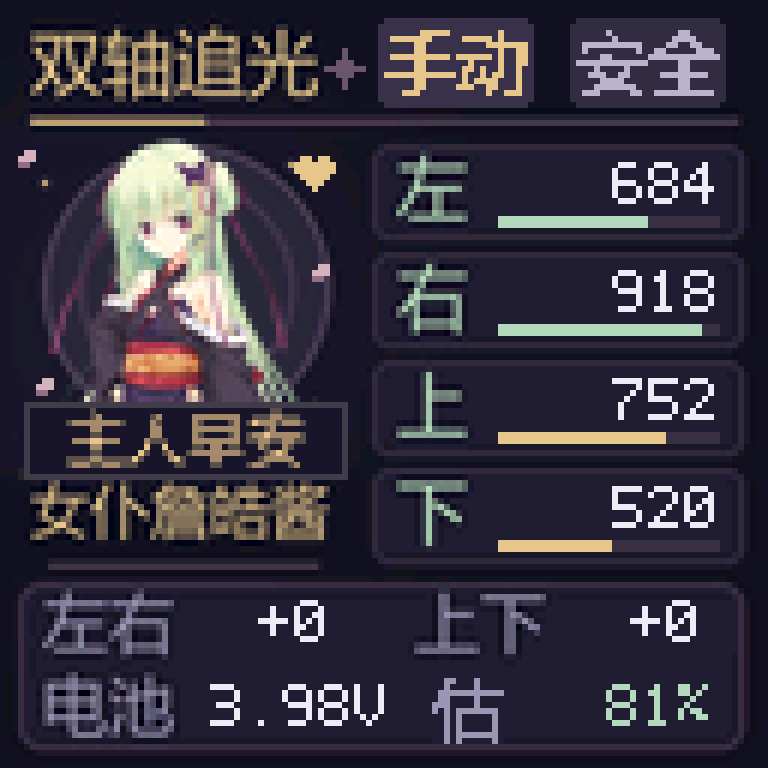
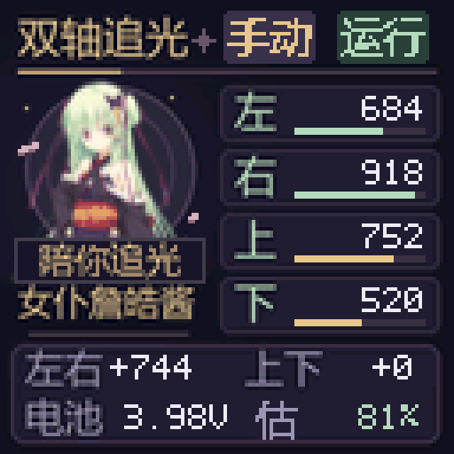
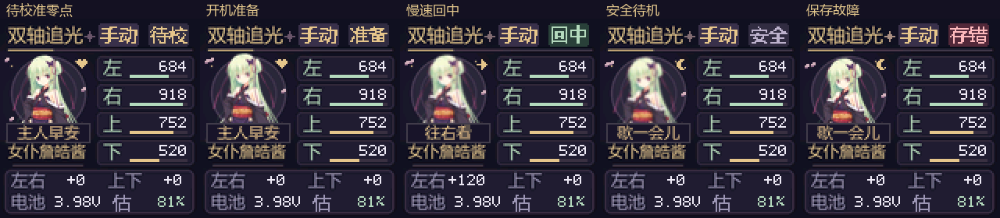

# STM32 双轴追光控制器

基于 STM32F103C8T6、两台 28BYJ-48 步进电机、四路光敏采样和 ST7735 128×128 彩屏的双轴追光固件。使用裸机 C 和 GNU Arm 工具链，支持自动追光、按键手动控制、中文监测界面和角色互动动画。



v1.1.0 新增不加传感器的记忆位置回中：正常停稳后保存步数，下次开机慢速回到已校准零点；运动中断电则要求重新校准。首次使用需按下面的说明设置零点。

## 功能

- 自动比较左右、上下亮度，通过死区和回差减少来回抖动；暗处停止追光。
- 手动点按或按住控制左右、上下；回中结束后保持安全停机。
- 保存已校准零点及停稳位置，上电延时回中；双键请求回中，任意新按键取消。
- 运动前写入未完成标记，运动中断电不误用旧位置；存储校验失败要求重设零点。
- 四路相对亮度、电池电压、估计电量和双轴相对位置显示。
- 保留《千恋＊万花》丛雨主题与自定义昵称“女仆詹皓酱”，共 23 种状态反应。
- 人物转向缓动、停下回弹、衣摆跟随、呼吸和渐变眨眼，动画目标更新间隔 60ms。
- 分方向的限位提示约 1.05 秒后收起；另一轴运动优先显示，到头轴的位置数字变金色。
- ST-Link 烧录前核对芯片、Flash 容量与读保护，备份原程序，写入后校验并回读 SHA-256。



预览由固件实际 ARM 指令的屏幕输出生成，使用演示数据，不是实时硬件截图。互动细节见 [互动效果说明](互动效果说明.md)，全部状态见 [状态对照图](docs/ui-states-contact.png)。

## 硬件与接线

| 功能 | 引脚或规格 |
|---|---|
| MCU | STM32F103C8T6，64KiB Flash / 20KiB RAM |
| J1 / U2 电机 IN1..IN4 | PB3、PB8、PB1、PB0 |
| J2 / U3 电机 IN1..IN4 | PB7、PB6、PB5、PB4 |
| 光敏左 / 上 / 右 / 下 | PA0、PA1、PA2、PA3 |
| 电池分压 | PA4，10kΩ / 10kΩ |
| S1..S5 按键，低电平有效 | PA5、PA6、PA7、PA8、PA11 |
| TFT SCK / MOSI / RESET / DC / CS / BL | PB10、PB11、PB12、PB13、PB14、PB15 |
| USART1 TX / RX | PA9 / PA10，115200 8N1，3.3V 逻辑 |
| SWDIO / SWCLK | PA13 / PA14，关闭 JTAG、保留 SWD |

光敏 J4 的 1..5 脚依次为 GND、PA3、PA2、PA1、PA0。电机必须由板上对应的驱动电路供电；ST-Link 给主控供电不代表电机 5V 电源已经接通。

位置单位是半步，亮度 0–1000 为相对值，电量百分比按电压粗估。左右 ±768、上下 ±384 半步是保守的软件范围，**没有机械限位传感器，也未标定实际最大角度**。零点需由用户校准，固件按保存的步数估计回中，不执行撞限位归零。电机失步、缺电运行和断电后被碰动不能自动检测，发生后必须重设零点。具体参数见 [tracker_config.h](src/tracker_config.h)。

## 使用

1. 首次开机显示“待校”。短按 S5 切换模式；长按约 1.5 秒启停。未校准时只允许手动运行。
2. 手动运行时，S1 左、S2 下、S3 右、S4 上；点按请求 16 半步，按住超过 350ms 连续移动。同轴相反键同时按下停止该轴。
3. 自动运行每 100ms 比较亮度。未接光敏板、环境过暗或亮度差很小时，电机不主动转动。
4. 首次把机构调到期望初始姿态，长按 S5 停止，再同时按住 **S1＋S3（左＋右）约 2.5 秒**保存零点。
5. 正常停稳约 0.5 秒后保存位置。下次开机延时约 1.5 秒慢速回中，到零点后进入安全停机；电机供电需先于或同时与主控接通。
6. 同时按住 **S2＋S4（下＋上）约 1.5 秒**可随时请求回中，走到软件边界也能返回。准备阶段任意键取消，回中期间新按下任意键立即停止。
7. 运动中突然断电、首次安装、记录损坏会提示“待校”；重新对齐后设零点。实际电机方向和光敏板安装方向仍需按机构确认。

操作和限制详见 **[回中与零点](回中与零点.md)**。最后两页 Flash 留给位置日志，程序可用空间为 62 KiB。



串口命令：`STATUS`、`HELP`、`AUTO`、`MANUAL`、`ARM`、`STOP`、`HOME`、`LEFT`、`RIGHT`、`UP`、`DOWN`。安全状态下用 `ZERO` 保存当前零点；`REV PAN` / `REV TILT` 改方向后必须重新对齐并 `ZERO`，新方向随零点保存；`CAL` 在均匀亮光下校准，其光感偏移仅保存在 RAM。

## 已编译固件与烧录

[prebuilt](prebuilt) 包含已写入实物并回读验证的 BIN、HEX 和 ELF，以及 [SHA256SUMS](prebuilt/SHA256SUMS)。BIN 起始地址为 `0x08000000`。

在 Windows 上下载 [xPack OpenOCD 0.12.0-7](https://github.com/xpack-dev-tools/openocd-xpack/releases/tag/v0.12.0-7)，解压为：

```text
tools/openocd/xpack-openocd-0.12.0-7/bin/openocd.exe
```

也可通过 `OPENOCD_EXE` 环境变量指定已有 OpenOCD，或将其加入 PATH。安装与你的 ST-Link 匹配的驱动并接好 SWD，然后双击 `Flash.cmd`。脚本优先使用 `build/` 的新编译固件；没有编译产物时使用 `prebuilt/`。

PowerShell 也可运行：

```powershell
.lash.ps1
```

`Flash.cmd` 只对本次 PowerShell 进程使用执行策略参数，不修改系统策略。脚本兼容 Windows PowerShell 5.1 的 OpenOCD 正常 stderr 日志，通过退出码识别真实失败。备份与日志生成在 `backups/`、`evidence/`，不会被 Git 跟踪。

## 从源码编译

使用 [GNU Arm Toolchain 13.3.Rel1](https://developer.arm.com/downloads/-/arm-gnu-toolchain-downloads) 的 Windows `arm-none-eabi` 版本。可以将工具链解压为：

```text
tools/arm-gnu/arm-gnu-toolchain-13.3.rel1-mingw-w64-i686-arm-none-eabi/bin/
```

也可将 `ARM_GNU_BIN` 指向工具链的 `bin` 目录，或将工具链加入 PATH，然后运行：

```powershell
.uild.ps1
```

输出为 `build/tracker.bin`、`tracker.hex`、`tracker.elf` 和链接映射文件。生成好的背景、中文字模和立绘数据已在 `src/`，正常编译不需要 Python。

## 验证和修改素材

需要 Python 3.12；生成中文素材和预览还使用 Windows 的微软雅黑字体。

```powershell
python -m venv .venv
./.venv/Scripts/python.exe -m pip install -r requirements-dev.txt
./.venv/Scripts/python.exe tests/run_tests.py
./.venv/Scripts/python.exe tests/run_position_tests.py
./.venv/Scripts/python.exe tests/render_ui.py
```

控制逻辑通过 10876 项 ARM 检查；另有 2117 项位置日志检查和 39 项实际主程序状态检查，覆盖写入每个阶段断电、日志换页、开机回中、双键校准、边界回中、取消、超时和存储失败。屏幕实际命令流通过 157 项状态与边缘检查，覆盖全部 23 种反应及回中状态。验证摘要在 [docs/validation.json](docs/validation.json)。固件已完成 ST-Link 写入、OpenOCD 校验和 Flash 回读一致性检查；物理零点需由用户现场校准，完整机械回中尚待装配后验证。

修改提示文案、背景或人物素材后运行 `tests/gen_ui_assets.py`，再编译并验证。此脚本生成 `src/ui_assets.h` 和 `assets/ui_background.rgb565`；运行时不依赖网络或 SD 卡。

## 目录

- `src/`：主程序、控制、板级初始化、显示、互动动画与生成资源。
- `tests/`：控制逻辑 ARM 仿真、屏幕输出验证与资源生成。
- `assets/`：主题素材及来源记录。
- `prebuilt/`：已验证固件与哈希。
- `docs/`：动画、界面预览与验证摘要。

角色素材与字体等第三方内容的权利归各权利人所有，来源和使用说明见 [NOTICE.md](NOTICE.md) 与 [assets/SOURCE.json](assets/SOURCE.json)。公开仓库未为第三方素材授予额外使用权。
